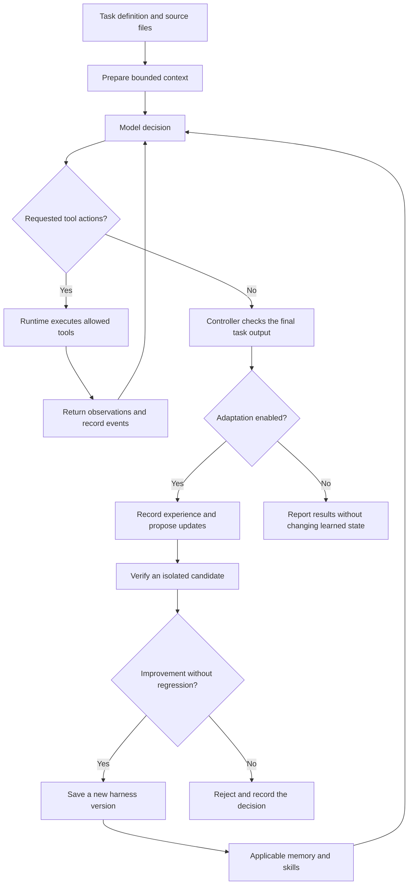
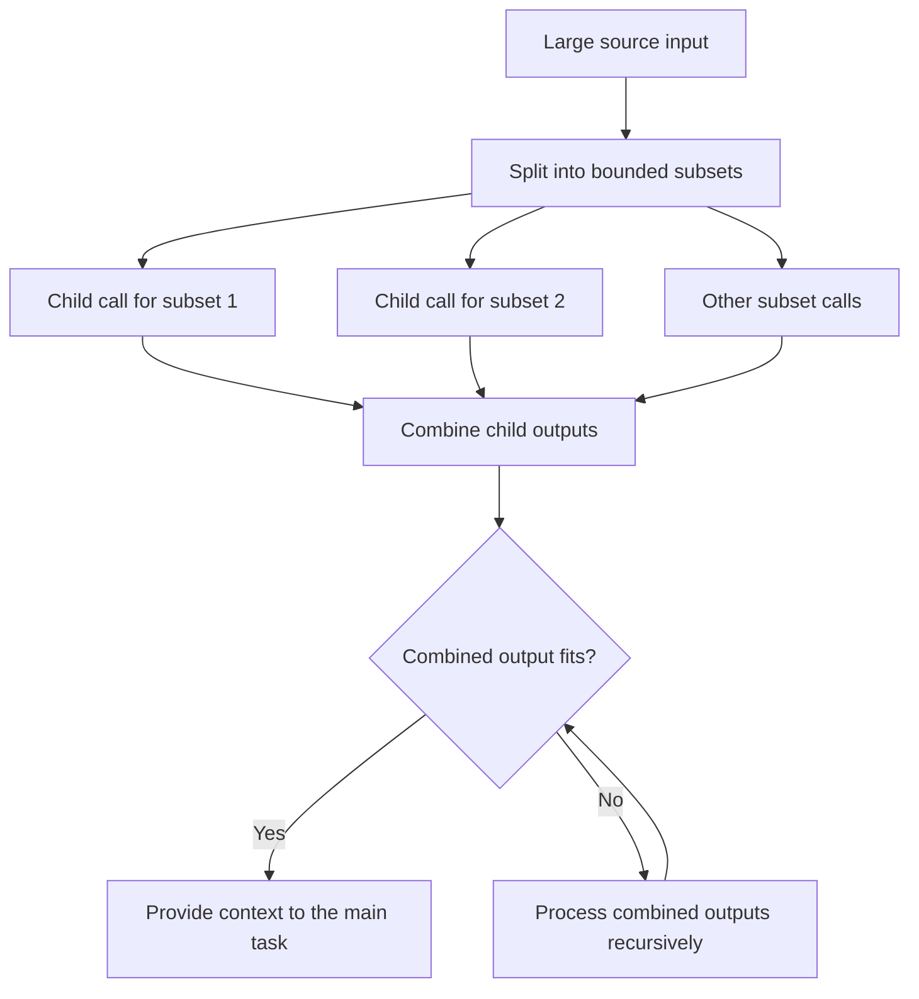

# Adaptive Self-Improving Agent Harness

## A simple explanation of the project, its components, and its code flow

**Prepared for:** Project discussion with the professor  
**Authors:** Abhinav Pratap Singh and Prasoon Manglam  
**Mentor:** Dr. Ashish Joshi  
**Institution:** University School of Automation and Robotics, GGSIPU  
**Guide date:** 12 October 2026  
**Current stage:** Working local Python prototype with offline mock-model validation

> **Update, 22 November 2026.** This guide was written on 12 October, before the game experiments. Since then a real fixed model, `gemini-3.1-flash-lite`, has run tic-tac-toe and Battleship pilots through the same harness. Neither showed a held-out improvement: see the [Battleship results](gemini-battleship-results-20261018.md) and the [tic-tac-toe pilot](gemini-game-pilot-20261017.md). The **coding** results in this guide are still mock-model results. An audit in November fixed several verification and robustness defects; the test suite now has 101 passing tests. The coding experiments were re-run on the current code. Completion, model calls, tool calls and accepted/rejected changes all matched. Estimated token counts are about 3–6% higher, because the saved October runs predate the switch to native tool-call messages. The token figures below show the current code, with the October values in brackets ([audit](audit-20261122.md)).

This guide explains the implementation that currently exists. Short code excerpts illustrate the important mechanisms. Blocks labelled **pseudocode** explain the flow and are not standalone runnable programs.

## 1. The project in one minute

> Our project develops a software harness around a fixed AI model. The harness manages the task, tools, context, memory, and checks. It processes large inputs through smaller recursive model calls and proposes reusable procedures from task experience. Before saving a change, it compares the candidate harness with the existing harness on separate verification tasks. We have implemented this locally in Python and tested the mechanisms with a deterministic mock model. The offline example reduced held-out model calls from ten to eight while maintaining task completion. Our next step is evaluation with a real fixed model on larger repository tasks.

The central idea is that an assistant can improve its working method while keeping the same underlying model.

## 2. The problem and the objective

An agent performing a coding task may need to inspect files, identify a relevant function, edit it, and check the result. Longer tasks introduce two practical problems:

1. The source context can exceed the amount of text the agent actively uses at once.
2. The agent can repeat useful tool procedures across tasks, requiring additional model decisions each time.

Our objective is to build a harness that handles these situations through bounded context processing and reusable external state. The research question is whether these mechanisms help a fixed model complete longer tasks more efficiently and reliably.

The current prototype demonstrates operation on small coding fixtures. Broader improvements in real-model reasoning remain a research objective.

**A useful analogy:** A student keeps the same brain but develops better notes, a useful checklist, and a method for reading a large book in parts. The model corresponds to the brain. The harness corresponds to the notes, checklist, and working method.

## 3. What exactly is a harness?

A harness is the software surrounding a model. It decides what information to supply, executes allowed actions, keeps records, and checks results.

The model can request an action. The harness performs the action and returns an observation. This repeats until the task ends or a resource limit stops execution.

| Term | Meaning in this project | Simple example |
|---|---|---|
| Model | Component that returns text or requested actions | Request a read of `solution.py` |
| Harness | Software that controls the model's task execution | Read the file, return its contents, and count the tool call |
| Context | Information supplied for the current model decision | The task goal and selected source content |
| Tool | An operation the harness can execute | Search, read, write, or verify |
| Memory | Stored information that may apply to future work | A project-specific procedure |
| Skill | A reusable sequence of bounded tool operations | Search for a target and read it |
| Trajectory | Record of the steps taken during a task | Model requests, tool results, errors, and checks |
| Candidate | An isolated harness state containing a proposed change | The existing harness with one additional skill |
| Verification gate | A rule deciding whether an update should persist | Accept a beneficial change that causes no completion regression |

The harness is a local Python package. SQLite stores persistent state. JSON and JSONL files record experiments. Docker is unnecessary for this implementation.

## 4. The overall design



If the Markdown viewer does not display Mermaid diagrams, explain the flow as:

**Task → context and applicable state → model decision → tools → observations → task check → optional update proposal → independent verification → save or reject.**

There are two distinct loops:

- **Task execution loop:** Call the model and execute tools until the task finishes.
- **Adaptation loop:** Use adaptation experience to propose and verify changes for future tasks.

Completing a task does not automatically mean a proposed harness change is accepted.

## 5. Where each component lives in the code

| Component | Main code | Responsibility |
|---|---|---|
| Command-line interface | [cli/main.py](../agent_harness/cli/main.py) | Reads commands, configuration, task paths, and experiment options |
| Experiment controller | [evaluation/benchmark.py](../agent_harness/evaluation/benchmark.py) | Runs tasks, invokes refinement, separates evaluation phases, and writes results |
| Orchestrator | [core/agent.py](../agent_harness/core/agent.py) | Coordinates the model–tool loop for one task |
| Model interface and mock | [models/base.py](../agent_harness/models/base.py), [models/mock.py](../agent_harness/models/mock.py) | Standardizes responses and provides deterministic fixture behavior |
| Inference adapter | [models/openai_compatible.py](../agent_harness/models/openai_compatible.py) | Sends requests to a compatible inference endpoint |
| Context engine | [core/context.py](../agent_harness/core/context.py) | Selects source context and performs recursive subset calls |
| Runtime and budget | [core/runtime.py](../agent_harness/core/runtime.py), [core/budget.py](../agent_harness/core/budget.py) | Dispatches tools, records their outcomes, and tracks resource use |
| Coding environment | [environments/coding.py](../agent_harness/environments/coding.py) | Manages task workspaces, file access, and independent task checks |
| Persistent state and memory | [storage/state.py](../agent_harness/storage/state.py), [memory/sqlite_store.py](../agent_harness/memory/sqlite_store.py) | Stores external state, retrieves memory, and maintains versions |
| Skills | [skills/registry.py](../agent_harness/skills/registry.py), [skills/executor.py](../agent_harness/skills/executor.py) | Lists applicable skills and executes validated workflows |
| Specialists | [agents/coordinator.py](../agent_harness/agents/coordinator.py) | Runs focused model calls using specialist instructions |
| Refiner and change policy | [refinement/refiner.py](../agent_harness/refinement/refiner.py), [refinement/policy.py](../agent_harness/refinement/policy.py) | Proposes bounded updates and validates their evidence and allowed fields |
| Update verifier | [verification/verifier.py](../agent_harness/verification/verifier.py) | Compares baseline and candidate behavior before promotion |
| Logging and object storage | [core/trajectory.py](../agent_harness/core/trajectory.py) | Records task events and stores content under hash references |

**Suggested explanation:** “The orchestrator handles one task. The experiment controller handles learning and evaluation across tasks. The runtime performs tools, and the verifier decides whether an update should become permanent.”

## 6. A task from start to finish

### 6.1 Load the task

The supplied [example task](../benchmarks/example_task.json) asks the agent to repair a sum function. A shortened excerpt is:

```json
{
  "task_id": "adapt-sum",
  "split": "adaptation",
  "project": "alpha",
  "goal": "Return the sum of values",
  "target": "solution.py",
  "writable_paths": ["solution.py"]
}
```

The complete task also contains source files and independent checks. The starting source is:

```python
def solve(values):
    return -999
```

`Task.visible()` exposes the goal and task metadata. It excludes check definitions and expected outputs from the model's visible task description.

The coding environment creates a task workspace and writes the supplied starting files into it. The agent can edit only files declared in `writable_paths` through the file API.

### 6.2 Load applicable state and prepare context

`Orchestrator.run()` retrieves applicable memory and skills, then asks the context engine to prepare source information.

Relevant excerpts are:

```python
memories = memory.retrieve(task.goal, task.project, task.task_id)
available_skills = skills.available(task.family, task.project)
```

The model receives the task goal, selected context, applicable memory, strategy notes, specialist advice when used, and descriptions of available skills.

The model does not receive unrestricted access to the SQLite database.

### 6.3 Run the model–tool loop

The following is **pseudocode** for the orchestrator:

```python
while True:
    response = call_model(model, messages, available_tools, ...)

    if not response.actions:
        final_message = response.content
        break

    for action in response.actions:
        observation = runtime.call(action.name, action.arguments)
        messages.append(observation)
```

The actual response interface uses an `Action` object:

```python
Action("read", {"path": "solution.py"})
```

`Runtime.call()` checks that the tool is enabled, reserves a tool call from the budget, records the request, and invokes the corresponding method. It returns either a result or an error observation.

This lets the next model decision use the result of the previous action.

### 6.4 Write the result and independently check it

For the sum fixture, the corrected function is:

```python
def solve(values):
    return sum(values)
```

The controller checks cases such as:

| Input | Expected output |
|---|---:|
| `[1, 2, 3]` | 6 |
| `[]` | 0 |

Offline function checks use a bounded interpreter over Python's abstract syntax tree. This supports the simple fixture functions without running arbitrary source through Python `eval` or `exec`.

The model may request an in-task `verify` action. The controller also performs independent final measurement, including in configurations that disable that action.

A completion message alone is insufficient. The task must pass its checks, and an execution error prevents overall success.

### 6.5 Record the outcome

The record includes verified completion, model calls, tool calls, tokens, latency, skill reuse, errors, and harness version.

When learning is enabled for an adaptation task, the experiment controller archives this experience and invokes the refiner. Ordinary execution and held-out evaluation do not invoke learning.

## 7. Recursive context processing in simple terms

### 7.1 What RLM means here

RLM means **Recursive Language Model**. Our implementation uses an RLM-style context mechanism around a fixed model interface.

It is not the name of a separately trained model in this project. A child call is another inference request using the model, with a smaller piece of context.

**Analogy:** Read relevant chapters separately, write short notes, and combine those notes to answer a question about a large book.

### 7.2 What the code does

`ContextEngine.prepare()` ranks supplied source objects using query-term matches. If recursive mode is enabled and the source text exceeds `max_context_chars`, it calls `_recursive()`.

The chunking code follows this pattern:

```python
for name, text in objects:
    chunks.extend(
        (name, text[i:i + limit])
        for i in range(0, len(text), limit)
    )
```

Each chunk goes to a model call with instructions to return relevant evidence from that subset. The code bounds each child output and combines the outputs:

```python
combined = "\n".join(outputs)

if len(combined) > limit:
    return self.prepare(
        {"child_outputs": combined},
        query,
        "recursive",
        depth + 1,
    )
```

Thus, recursion can operate on the child outputs if their combined size remains too large. It stops when they fit or when the depth/resource limits prevent further work.



Child calls run sequentially in the current implementation. The diagram shows their relationship, not parallel execution.

### 7.3 External context and working history

`Objects.put()` stores content under a SHA-256 hash reference. The hash acts as an address for that stored content. Repeated identical content can reuse the same stored object.

The runtime can retrieve a bounded character range from a task-approved reference. Oversized observations and older conversation history can also be placed in object storage, leaving a reference in the working conversation.

This makes detailed content addressable without repeatedly including all of it in the active prompt. Selecting smaller context still risks omitting useful details, so real-model evaluation must examine retrieval and aggregation quality.

### 7.4 What we have demonstrated

The recursive fixture completed with **3 child calls**, **8 total model calls**, and **13,708 estimated fixture tokens** (October run: 13,336).

The mock's context responses are bounded text extracts. They do not demonstrate semantic summarization or stronger reasoning by a real LLM.

**Suggested explanation:** “We have implemented the recursive call and budget mechanism. The next experiment must test whether a real model selects and combines useful evidence effectively.”

## 8. Memory, skills, specialists, and strategy notes

These are different kinds of external harness state.

### 8.1 Memory

Memory entries contain content, type, scope, confidence, provenance, and version information.

The supported types are working, episodic, semantic, and procedural. Scope controls where an entry can apply:

- **Task scope:** Relevant only to its owning task.
- **Project scope:** Relevant only to its owning project.
- **Global scope:** Intended for broader reuse, with supporting evidence requirements.

The change policy requires evidence from different projects for global memory. Retrieval excludes inactive entries, low-confidence entries, and entries outside the current task/project scope. It scores relevant entries by keyword overlap weighted by confidence.

This is currently keyword-based retrieval. It does not use embeddings or a vector database.

**Example:** A procedure learned in project Alpha should not automatically become a factual claim about project Beta.

### 8.2 Skills

A skill is an executable tool procedure. The current restricted workflow format permits one to eight steps using `search`, `read`, and `verify`. Its input parameter is `path`.

The learned example is:

```python
implementation = [
    {"tool": "search", "arguments": {"query": "$path"}},
    {"tool": "read", "arguments": {"path": "$path"}},
]
```

The executor replaces `$path` with the current task's path and runs the steps through the same controlled runtime. A candidate skill must pass independent replay validation before activation.

The procedure stores how to inspect a target. It does not store the answer to a sum problem or the final source patch. The model still supplies the later edit.

### 8.3 Specialists

A specialist is a stored role definition with instructions and capabilities, such as a source inspector. The coordinator uses those instructions for a focused model call.

The current specialist receives bounded target-source content and returns advice. It shares the parent's execution budget and does not receive the entire persistent database. Automatic selection currently chooses at most one applicable specialist.

An RLM child handles an input subset. A specialist handles a focused role. Both use the model interface, but they serve different purposes.

Dynamic specialists must demonstrate positive marginal contribution on independent verification tasks before persistence. Supporting specialist proposals does not mean the final demo accepted one: the reported accepted change was a skill.

### 8.4 Strategy notes

Strategy notes are persistent instructions supplied to future task executions. An example encourages source inspection and independent verification before claiming completion.

Notes are external instructions. They do not change model weights. Their proposals also pass the applicable change policy and, in E8, the comparative gate.

## 9. How the current self-improvement is implemented

### 9.1 Experience comes from adaptation tasks

`Experiment.run_task()` runs the task, records its outcome, and archives adaptation experience in SQLite. This archive can accumulate across separate process runs.

The code prevents verification and held-out tasks from supplying persistence evidence. Saving an experience record by itself is not a learned harness improvement: an actual state change must be accepted.

### 9.2 The offline refiner uses explicit rules

`HarnessRefiner.propose()` checks successful adaptation records for a search action followed by a read action. At least two distinct task IDs must provide evidence before the reusable workflow proposal is generated.

The relevant detection is:

```python
if (
    "search" in names
    and "read" in names
    and names.index("search") < names.index("read")
):
    read_successes.append(record)
```

When the evidence is sufficient and no skill is already stored, it proposes the predefined parameterized `inspect_target` workflow shown earlier.

**The detection rule and supported workflow are written by the programmer.** The prototype does not learn arbitrary Python algorithms from scratch. Its adaptive behavior is recognizing supporting experience, proposing a reusable external procedure, verifying it, and deciding whether it should persist.

The refiner also contains rules for memory updates, skill feedback, specialist proposals, and strategy notes. Configurations determine which categories are available.

### 9.3 An optional model-assisted path exists

For a non-mock backend, the refiner can ask the same fixed model for bounded JSON proposals using adaptation summaries. Those proposals undergo the same validation and verification process.

This coding refiner path has still not run with a real model. The game pilots used a separate game-strategy refiner. Scripted tests of proposal handling demonstrate parsing and policy behavior rather than autonomous learning ability of a real LLM.

### 9.4 Proposals have restricted targets

`validate_change()` checks the change category, allowed fields, provenance, adaptation evidence, scope, and whether the old state is still current.

Allowed changes target memory, skills, agents, or strategy notes. The policy does not allow these proposals to modify model parameters, implementation code, experiment configuration, or verification definitions.

**Suggested explanation:** “Our current self-improvement updates structured external state. The offline example uses a limited rule to propose a repeated tool workflow, and measured verification decides whether it becomes part of the harness.”

## 10. Verification before persistence

### 10.1 Two different meanings of verification

| Check | What it asks | Where it happens |
|---|---|---|
| Task verification | Does the produced output satisfy the task checks? | `CodingEnvironment.verify()` |
| Update verification | Does this proposed harness change improve measured performance? | `Verifier.compare()` and `Verifier.apply()` |

Passing a task test does not prove that an update helps future tasks.

### 10.2 Stage a candidate in isolation

The verifier validates the proposal and clones the current harness state into an in-memory SQLite candidate. It applies the proposed change to this candidate, leaving the current state untouched during the comparison.

Executable skills first undergo independent workflow replay. Dynamic specialists also need a positive contribution check.

### 10.3 Compare the existing harness and candidate

In E8, the verifier runs the baseline and candidate on the same separate verification tasks with the same model configuration and per-task resource limits.

The current score averages this expression across verification tasks:

```text
verified_completion
  - 0.001 × model_calls
  - 0.0000001 × tokens
  - 0.0001 × tool_calls
```

Here, verified completion is 1 for passing the task checks and 0 otherwise. The other terms penalize additional resource use. These weights are prototype design choices, not universal measures of agent quality.

The acceptance rule requires both:

1. No task that the baseline passed becomes a failure under the candidate.
2. The candidate's score improves by at least the configured positive threshold, `epsilon`.

The comparison uses:

```python
delta = score(after) - score(before)

accepted = not regressions and delta >= self._config.epsilon
```

This allows an efficiency improvement even when completion remains unchanged. The verifier records the extra calls and tokens spent making the decision.

### 10.4 Save or reject

On acceptance, `State.promote()` saves entries, version metadata, and the authoritative snapshot in one SQLite transaction. On rejection, the existing harness remains in place and an audit event records the decision.

`State.rollback(version)` restores an earlier snapshot after checking its digest. Rollback is supported, but the reported demo did not require a rollback event.

The hash-chain audit helps detect changes to the stored record. It is not an externally signed guarantee against an adversary.

## 11. Why learning reduced model calls in the mock example

Before skill acquisition, the mock makes five model requests per held-out task:

| Request | Response |
|---|---|
| 1 | Request `search` |
| 2 | Request `read` |
| 3 | Request `write` |
| 4 | Request `verify` |
| 5 | Return a completion message |

After acquisition, it makes four:

| Request | Response |
|---|---|
| 1 | Invoke the skill, which internally searches and reads |
| 2 | Request `write` |
| 3 | Request `verify` |
| 4 | Return a completion message |

The harness still performs the underlying search and read. It reduces the number of separate model decisions needed to request them.

Across two held-out tasks, this produces **10 calls before learning and 8 afterward**, a **20% reduction**.

Runtime tool calls increase from 8 to 10 because the skill wrapper invocation counts in addition to its internal steps. This is why we report model calls and tool calls separately.

**Suggested explanation:** “The benefit in our fixture is procedural reuse. One model request invokes a saved procedure containing two operations, replacing two separate requests.”

## 12. What model was actually used?

All reported offline experiments used **`fixture-policy-v1`**, implemented by `MockModel`.

It is a deterministic Python policy, not a trained LLM. Its `solution()` method checks the goal and returns predefined code templates for sum, maximum, or count fixtures. Its `generate()` method chooses a predictable next action from the available tools and previous observations.

It also returns bounded text extracts for recursive context calls. Therefore, the recursive experiment checks the call mechanism rather than real-model understanding of large context.

The project provides a compatible inference adapter for an existing local or remote server. It sends requests, parses structured tool calls, and records usage and latency. A local simulated API server tested the adapter's wire behavior. No real LLM was used for the coding results. The later game pilots (17–18 October) used Gemini through this adapter.

The default mock configuration includes endpoint fields, but selecting `backend: mock` uses the mock implementation and does not invoke that endpoint.

**Answer to the professor:** “We first used a deterministic mock to verify orchestration, recursion, persistence, and update decisions reproducibly. We still need real-model experiments before claiming improved reasoning.”

## 13. Fair evaluation and experiment configurations

### 13.1 Three task splits

| Split | Tasks in the reported example | Role |
|---|---:|---|
| Adaptation | 3 | Supply experience for update proposals |
| Candidate verification | 2 | Decide which updates should persist |
| Held-out evaluation | 2 | Compare frozen initial and learned harnesses in new fixture projects |

The benchmark measures the initial harness, runs adaptation, and then measures the learned harness. Held-out results do not feed into the adaptation archive or select updates.

State fingerprints before and after measurement detect unintended changes to the learned registries. Even usage counters remain frozen during evaluation; reuse is recorded in experiment logs instead.

### 13.2 E0–E8 conditions

| Condition | Mechanism under study |
|---|---|
| E0 | Direct model output with independent outcome measurement |
| E1 | Tools and in-task verification |
| E2 | Scoped persistent memory |
| E3 | Recursive context and a temporary child specialist |
| E4 | Fixed specialist registry |
| E5 | Evaluated dynamic specialists |
| E6 | Validated reusable skills |
| E7 | Continual refinement with the comparative persistence gate disabled |
| E8 | Comparative verification gate with versioning and rollback |

All conditions share one implementation. Recursive context remains enabled from E3 onward and triggers additional calls only when the input exceeds the active context budget. E7 still retains structural and component validation. Lower configurations retain snapshots for audit/recovery even when versioning is not their experimental treatment.

The comparison ran nine conditions with seeds 0 and 1, producing 18 offline runs. Seeds vary adaptation order. Repeated deterministic mock runs do not establish statistical evidence about a stochastic LLM.

## 14. Progress and results we can present accurately

When this guide was written, local validation passed **37 automated tests**. As of 22 November 2026 the suite has **101 passing tests**. Coverage includes scoped state, skill and specialist lifecycle behavior, recursion limits, accepted/rejected updates, recovery, and separation of adaptation from evaluation.

The saved E8 example reports:

| Measurement | Initial harness | Learned harness |
|---|---:|---:|
| Held-out verified completion | 2 of 2 | 2 of 2 |
| Completion rate | 100% | 100% |
| Model calls | 10 | 8 |
| Estimated fixture tokens | 12,590 (Oct: 11,849) | 10,515 (Oct: 10,071) |
| Runtime tool calls | 8 | 10 |
| Successful skill reuse | No learned skill | 2 of 2 held-out tasks |

The update process accepted **1 reusable skill** and rejected **8 proposals**. Completion did not increase, so the measured capability transfer gain is **0 percentage points**. Estimated task-inference tokens decreased by approximately **16.5%** (October run: 15%).

Candidate verification added **154 model calls** and **197,441 estimated fixture tokens** (October run: 187,956). The later task-inference savings therefore do not demonstrate lower total adaptation-plus-evaluation computation.

Mock token values use the project's character-based estimate rather than a real model tokenizer. They are not paid API usage measurements.

Evidence: [current-code re-run](../runs/audit-20261122/demo/experiment_summary.json), [final demo summary](../runs/final-demo/experiment_summary.json), [recursive summary](../runs/recursive/experiment_summary.json), and [E0–E8 comparison](../runs/comparison/comparison.csv).

## 15. Budgets, boundaries, and reproducible records

The supplied [E8 configuration](../configs/e8.yaml) declares:

| Limit | Value |
|---|---:|
| Recursive depth | 2 |
| Model calls per task budget | 24 |
| Child/specialist calls | 6 |
| Total token allowance | 24,000 |
| Execution time | 60 seconds |
| Runtime tool calls | 40 |
| Selected-context character budget | 6,000 |

Main, recursive, and specialist calls share the task budget. Candidate comparison uses separate task executions with equal limits on the baseline and candidate, and reports their verification overhead separately.

The selected-context limit is a character limit on that context component. It is not a claim that the entire serialized prompt has exactly that maximum size.

File APIs resolve paths inside a task workspace and enforce a declared writable manifest. Optional repository command execution is disabled by default and requires an explicit opt-in for trusted code. It is not an operating-system sandbox.

The experiment saves:

| Artifact | What it records |
|---|---|
| `experiment_summary.json` | Configuration, task outcomes, grouped metrics, and interpretation |
| `trajectories.jsonl` | Model/tool events and task measurements |
| `changes.jsonl` | Proposed changes and their verification decisions |
| `state.db` | Persistent harness state and archived adaptation experience |
| `harness_history.json` | Version history |
| `comparison.csv` | Experiment comparisons |
| `objects/` | Prompts, observations, and source content addressed by hashes |

Configuration, dataset, and source hashes help identify which setup generated the result. Keeping these records makes the prototype reviewable and reproducible.

## 16. A short demonstration for the professor

Run commands from the project directory, the folder that contains `README.md`.

To show the learned skill and version history from the existing saved experiment, use these read-only commands:

```powershell
python -m agent_harness inspect-skills --state runs/final-demo/state.db
python -m agent_harness history --state runs/final-demo/state.db
```

Point to the skill's two operations, its provenance, active status, and validation record. Then show the before/after numbers in `runs/final-demo/experiment_summary.json`.

To reproduce the full offline experiment, choose a **fresh output directory**:

```powershell
python scripts/reproduce.py --output runs/professor-demo
```

If that directory already contains a run, choose another new name. The reproduction script deliberately refuses to overwrite an existing experiment.

To demonstrate recursive processing in a separate fresh workspace:

```powershell
python -m agent_harness run --config configs/e8.yaml --task benchmarks/recursive_task.json --state runs/professor-recursive/state.db --output runs/professor-recursive
```

Explain that the reproduction command performs adaptation and frozen evaluation, while the single recursive task command exercises context processing without learning.

The test suite can also be run with:

```powershell
python -m pytest
```

For a presentation, explain what the outputs mean instead of reading every log entry. A useful order is: task example, learned procedure, version history, result comparison, and pending real-model evaluation.

## 17. Suggested presentation sequence

| Approximate time | Topic | Main message |
|---|---|---|
| 1 minute | Problem and objective | Large context and repeated procedures motivate the harness |
| 1 minute | Components | The model proposes actions, and the harness controls execution |
| 2 minutes | Task execution | Follow the sum example through search, read, write, and verification |
| 1–2 minutes | Recursive context | Subset calls and aggregation handle oversized source inputs |
| 2 minutes | Self-improvement | Experience proposes a workflow, and independent tests decide persistence |
| 1 minute | Results | The mock used fewer later model calls with unchanged completion |
| 1 minute | Limits and next work | Real-model reasoning and total-cost gains still need evaluation |

These are speaking-time suggestions, not a historical project schedule. Adjust the detail to the available presentation time.

## 18. Likely professor questions

### Are you training a model?

No. The code performs inference and updates external harness state. There is no weight training or fine-tuning in this prototype.

### Which model produced the reported results?

For the coding results, `fixture-policy-v1`, a deterministic mock implemented in Python. A real model (`gemini-3.1-flash-lite`) has since run small game pilots. Neither pilot improved held-out play.

### What does “self-improvement” mean if the model stays fixed?

The surrounding system can acquire a useful procedure, memory entry, specialist definition, or strategy note. Its working method changes while the model parameters remain unchanged. In the reported example, one workflow skill was accepted.

### Is the current learning automatic?

The program automatically detects supporting adaptation experience and verifies proposals. However, the offline procedure detector and supported workflow template are explicitly programmed. It does not independently discover arbitrary algorithms. A model-assisted proposal path exists for future real-model evaluation.

### How does a skill help if the tools still execute?

A single model request can invoke several stored tool steps. It can reduce separate model decisions while retaining the underlying operations. In our example, this reduced model calls but increased the recorded tool-call count because of the wrapper invocation.

### Why do you need separate verification tasks?

A change that helped the task that produced it might not help other tasks. Separate verification tasks provide an independent basis for selecting the update. Held-out tasks then measure the frozen result without selecting further updates.

### Have you shown better reasoning?

We have shown functioning harness mechanisms on deterministic fixtures. We have not shown stronger reasoning by a real LLM or an increase in held-out task completion.

### Does the harness reduce overall cost?

The example reduces later task-inference calls. It also pays substantial candidate-verification overhead, so overall savings remain unverified. A larger experiment must measure both adaptation cost and later reuse benefits.

### What happens if an update is harmful?

E8 rejects a candidate that causes a verification completion regression or fails its improvement threshold. Persisted versions can also be restored through rollback.

### What will you do next?

Connect an existing fixed-model inference endpoint, run a repository pilot with independent checks, and repeat matched-budget comparisons across several runs. Evaluate larger contexts, negative transfer, and total adaptation-plus-evaluation cost.

## 19. Closing statement

> We have implemented a local harness that controls task execution, processes large context recursively, stores external state, and verifies proposed improvements before persistence. Our current evidence demonstrates that these mechanisms work with a deterministic mock. The next research stage will evaluate whether they provide useful reasoning and efficiency benefits with a real fixed model on larger tasks.

## 20. Supporting project files

- [README and reproduction instructions](../README.md)
- [Implementation boundaries](architecture.md)
- [Experiment design](experiments.md)
- [Recorded offline results](example-results.md)
- [Development instructions](development.md)
- [Progress report](../reports/Adaptive_Agent_Progress_Report.docx)
- [Project and progress presentation](../reports/presentations/Adaptive_Agent_Project_and_Progress_v2.pptx)

This guide summarizes the inspected implementation and saved experiment evidence. It does not introduce new experiments or claim that the prototype's research objectives have already been demonstrated with a real LLM.
